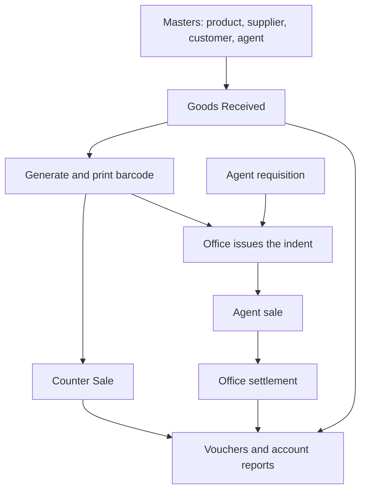
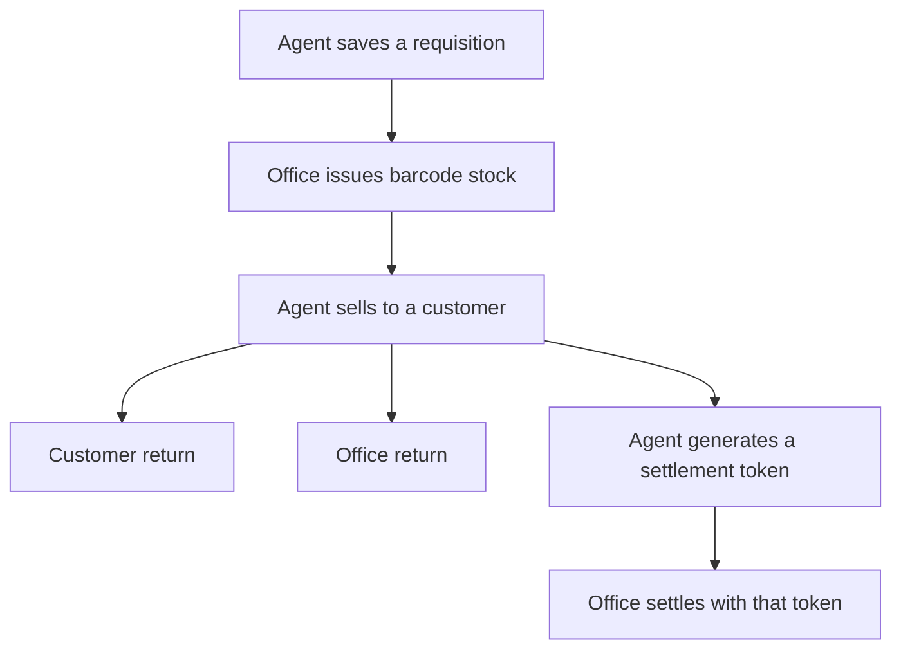

# Smart Inventory — project flow

This is the working flow of the Smart Inventory application used by Bagnan-I Mahila Bikash Consumer Cooperative Society Ltd. The office and the agents use the same Laravel project and the same society database. They sign in on different screens and see different menus.

The screens are Blade pages with jQuery. Almost every save follows the same path: the controller checks the form, loads the lines into a temporary MySQL table, and calls a stored procedure. The procedure writes the permanent tables and returns `Error_No` and `Message`. A negative `Error_No` is shown as an error and the transaction is rolled back.

## Two databases

| Connection | Database | What it holds |
|---|---|---|
| Default `mysql` | `smartinventory_core` | Organisation, branch, organisation config, application options, and migrations |
| `coops` | Society schema, here `smartinventory_bccsl` | Products, parties, stock, bills, vouchers, accounts, and agent work |

Login starts on the core database. `UDF_GET_ORG_SCHEMA` reads the 4-digit organisation code and returns the society schema name. The application then points the `coops` connection at that schema for the rest of the session.

Society procedures use unqualified table names, so they run against the schema on the `coops` connection. Accounting year, chart of accounts, product category, unit, and GST code data live in the society schema.

## Sign-in

Office login is `/`. The form asks for organisation code, user name, and password.

1. Core function `UDF_GET_ORG_SCHEMA` resolves the society database.
2. `USP_VALIDATE_USER_LOGIN` loads the user and the open accounting year from the society schema.
3. The password is checked in this order: bcrypt, then the older AES form, then a plain match.
4. The session stores the user, branch, organisation, schema, year, and GST settings.
5. The office menu is loaded for that user group by `USP_GET_SIDEBAR_MENUE`.

Agent login is `/agent/login`. It uses organisation code, agent code, and password, then `USP_VALIDATE_AGENT_LOGIN`. The agent menu comes from `mst_menus_agent` through `USP_GET_AGENT_MENUE`.

The open year on this society is **2026-2027**, from 1 April 2026 to 31 March 2027. Entry dates must fall inside that year and cannot be a future date.

`gst_type` 2 hides the GST columns on the sale screens. The amounts are still calculated and stored.

## How a bill moves



Purchase, counter sale, sale return, purchase return, agent sale, customer return, and wastage all create a trading bill in `trans_trading`, item lines in `trans_trading_products`, GST lines in `trans_trading_gst`, a stock row in `trns_stockinout`, and an accounts voucher.

## Office menu

The sidebar is the active rows in `mst_menus`. A row with no route is only a heading.

### Dashboard

`/Dashboard` shows purchase and sale totals, a monthly chart, reorder alerts, and notifications for pending barcodes and low stock.

### Master Setup

| Screen | Route | What it saves |
|---|---|---|
| Chart of Accounts | `chart-of-accounts` | Account heads |
| Product Master | `product-master` | Item, unit, category, GST, sale margin, reorder level |
| Agent Profile | `agent-profile` | Agent, login, stock limit |
| Member & Share | `member-share` | Member and share holding |
| Supplier Master | `supplier-master` | Party type 1 |
| Customer Master | `customer-master` | Party type 2, optionally linked to an agent |
| Address Master | `address-master` | District, police station, post office, village |
| Product Category | `prod-category` | Category and its purchase and sale ledgers |
| Product Sub Category | `prod-subcategory` | Sub category under a category |
| Unit Master | `unit-master` | KG, packet, piece, and the other units |
| Accounting Year | `accounting-year` | Financial year used at login |
| GST Codes | `gst-codes` | HSN and CGST / SGST rates |
| Counter Balance | `counter-balance` | Opening counter cash |
| Group Privileges | `user-roles` | Which menus a user group can open |
| User Creation | `user-creation` | Office user and password |

Organisation Profile, Barcode Setup, and User Group are menu headings. They do not open a screen.

### Purchase

**Goods Received** (`/good-received`) records a supplier purchase.

The line total is quantity × rate. Discount is taken off that total. GST is calculated on the amount after discount. Freight and round off are bill-level. Sale MRP is calculated on the screen and stored with the line. It is not GST-inclusive:

```text
net rate = rate × (1 − discount % / 100)
Sale MRP = net rate × (1 + product Sale_Margin % / 100)
```

A rate of 20 with no discount and a 10% margin stores Sale MRP 22. The same rate with 2% discount stores 21.56. GST is a separate amount on the bill. It is not added into Sale MRP.

Save calls `USP_ADD_EDIT_PURCHASE`. That writes trading type **2**, stock type **2**, and the purchase voucher. Payment mode is cash (1), bank (2), or credit (3). Bank mode also stores the instrument number.

**Purchase Return** (`/purchase-return`) returns quantity against an earlier purchase. The return quantity cannot exceed the remaining purchased quantity, and it cannot exceed the office barcode stock. Save calls `USP_ADD_EDIT_PURCHASE_RETURN` and writes trading type **4** and stock type **7**.

Production is a menu heading with no screen.

### Sales and issue

**Counter Sale** (`/counter-sale`) sells from office barcode stock. The cashier scans a barcode or picks an item, rate, and MRP that already exist on stock. Quantity on this screen is a whole number. Save calls `USP_ADD_EDIT_SALE`, writes trading type **3**, stock type **3**, and the sale voucher.

**Agent Indent** (`/agent-indent`) is the office issue of stock to an agent. Pending requisitions are loaded, the office picks the barcode and the MRP group that is already on stock, and save calls `USP_ADD_EDIT_AGENT_INDENT`. Each issued line writes stock type **4** and a row in `trans_agent_stock`. The indent is marked issued. A short issue stores the unissued part in `Reject_Qty`.

**Sales Return** (`/sale-return`) returns a counter-sale line. Quantity stays decimal. Save calls `USP_ADD_EDIT_SALE_RETURN` and writes trading type **5** and stock type **8**.

**Agent Return** (`/agent-return`) is the office receipt of goods an agent is sending back. Save calls `USP_ADD_EDIT_AGENT_OFFICE_RETURN` and writes stock type **6**.

**Agent Settlement** (`/agent-settlement`) takes the token the agent generated. `USP_SETTLE_AGENT_SALES` posts the unsettled agent sale bills into cash, bank, or sundry debtors and marks those bills settled.

### Inventory

**Wastage / Damage** (`/wastage-damage`) needs a scanned office barcode. Save calls `USP_ADD_EDIT_DAMAGE` and writes trading type **6** and stock type **9**.

Stock in / Stock out, Stock Level Alerts, and Inventory Reconciliation are menu headings with no screen. Batch & Expiry is inactive.

### Barcode

**Auto Generate SKU Barcodes** (`/barcode-label`) lists purchase lines that still need a barcode and calls `USP_GENERATE_BARCODE`.

**Print Barcode Labels** (`/print-barcode`) prints labels for generated barcodes.

### User management

Group Privileges and User Creation are the working screens. The menu a group can see is stored through `USP_ADD_USER_GROUP`.

### Support

`/support` opens the support ticket page for the logged-in office user.

## Agent menu

| Screen | Route | What the agent does |
|---|---|---|
| Dashboard | `/agent/dashboard` | Today’s figures, monthly sale and return, low stock |
| Item Requisition | `/agent/requisition` | Asks the office for stock |
| Item Sale | `/agent/sale` | Sells issued stock to a customer |
| Customer Payment | `/agent/customer-payment` | Collects money against a customer due |
| Customer Return | `/agent/customer-return` | Takes goods back from a customer |
| Office Return | `/agent/office-return` | Sends unsold goods back to the office |
| Office Settlement | `/agent/settlement` | Generates or cancels the settlement token |
| Register | under Register | Indent, Issue, Sales, Return, Stock, Customer Due |

### Requisition, issue, sale, return, settlement



1. **Item Requisition** saves with `USP_AGENT_REQUISITION` in mode 1 and indent type **1**. The number series is `AI`. Lines go into `trans_agent_indent` and `trans_agent_indent_details`. This step does not move stock.
2. Quantity on a requisition line must be from **1** to **32,767**. That is the maximum of the `SMALLINT` quantity columns. A larger number is stopped on the screen and again in the controller.
3. If the indent value plus the agent’s old stock crosses the agent stock limit, the screen asks for confirmation. Confirming still saves the requisition.
4. **Agent Indent** at the office issues that request. Unissued quantity is kept as `Reject_Qty`.
5. **Item Sale** saves with `USP_ADD_EDIT_AGENT_SALE`. The bill is trading type **3**, the stock row is type **5**, and the bill stays unsettled until office settlement. A credit sale can warn when it crosses the agent credit-sale limit.
6. **Customer Return** saves with `USP_ADD_EDIT_AGENT_SALE_RET` and writes trading type **5**. The return quantity cannot exceed the quantity that agent sold and has not already taken back.
7. **Office Return** saves another requisition through `USP_AGENT_REQUISITION`, this time with indent type **3**. The office then receives it on Agent Return, which brings the stock back as type **6**.
8. **Office Settlement** on the agent side creates a token with `USP` token procedures. The office searches that token and settles the open agent sales.

## Stock types

Every quantity movement is one row in `trns_stockinout`.

| Type | Meaning | Written by |
|---|---|---|
| 1 | Opening | Opening stock |
| 2 | Purchase | Goods Received |
| 3 | Counter sale | Counter Sale |
| 4 | Issued to agent | Agent Indent |
| 5 | Agent sale | Agent Item Sale |
| 6 | Agent return to office | Agent Return |
| 7 | Purchase return | Purchase Return |
| 8 | Sales return | Sales Return and customer return stock |
| 9 | Damage / wastage | Wastage / Damage |

Office stock adds opening, purchase, agent return, and sales return, and subtracts counter sale, agent issue, purchase return, and damage. A sales return is counted only when it belongs to a real sale. Barcode rows with a negative quantity are left out of closing stock. Closing stock uses quantity greater than 0.0001.

Agent stock is tied to the issue row through `trans_agent_stock`. An agent can sell or return only quantity that was issued to that agent and is still in hand.

## Trading types and payment

`trans_trading.Tranding_Type`:

| Type | Bill |
|---|---|
| 1 | Production |
| 2 | Purchase |
| 3 | Sale, including counter sale and agent sale |
| 4 | Purchase return |
| 5 | Sales return |
| 6 | Damage |

`Pay_Mode` on a bill, and `Vou_Mode` on a voucher:

| Mode | Meaning |
|---|---|
| 1 | Cash |
| 2 | Bank, with instrument number |
| 3 | Credit |

`trans_voucher_master.Vou_Type`:

| Type | Voucher |
|---|---|
| 1 | Receipt |
| 2 | Payment |
| 3 | Contra |
| 4 | Journal |

`Trans_Type` on the voucher says which business event created it: purchase, counter sale, agent sale, agent return, purchase return, sales return, damage, yearly adjustment, or a cash-book voucher.

The number series live in `stores_id`. The prefixes used by the screens are `PV` purchase, `INV` sale, `PR` purchase return, `SR` sale return, `AI` agent indent, `AR` agent return, `ID` damage, `REC` receipt, `PAY` payment, `JOU` journal, and `ACP` agent customer collection.

## Accounts

General Voucher, Supplier Payment, and Customer Collection are the manual entry screens. Purchase, sale, return, damage, and settlement post their own vouchers from the trading procedures.

Default ledgers in `mst_default_ledger`:

| Use | Ledger |
|---|---|
| Cash | Account 11, `200101` Cash in Hand. `Account_For` is `C` |
| Bank | Accounts 12 to 15. `Account_For` is `B` |
| Purchase credit | Account 3, `100301` Sundry Creditor |
| Sale credit | Account 19, `200109` Sundry Debtors |

Cash account closing includes transfers, so the grand totals match. The ledger book balance is cumulative debit minus credit, with Dr or Cr on every row and on the total. A sales-ledger debit of 0 is a valid balance.

Account reports, in menu order:

- Accounts User Scroll (`account-user-scroll`)
- Cash Book
- Journal Book
- Cash Account
- Ledger Book
- Receipt & Payment
- Trial Balance
- Trading and Profit & Loss
- Profit & Loss Appropriation
- Balance Sheet

The inventory User Scroll menu is inactive. The accounts User Scroll stays available.

## Inventory reports

- Stock Summary, with item detail
- Purchase Register and Item Wise Purchase
- Sales Register for counter, agent, and consolidated bills
- Agent Register for indent and stock
- Return Register for purchase and sales
- Supplier Register and Customer Register, including the party ledger
- Share Register
- GST Register
- Stock Statement
- Expiry Report
- Reorder Level Report
- Slow-moving and fast-moving items

Bill-wise sale and purchase registers use the same bill layout. Round off is the bill-level `Round_Off` on `trans_trading`.

## Bill print

Counter Sale and Agent Item Sale print the same slip.

- On a computer, the bill prints through a hidden frame to the USB thermal printer. The page is 72 mm wide.
- On an Android phone, the bill is drawn and sent to the RawBT app as a printer image, so the printer opens from the Print button.
- The slip shows organisation name, organisation address, branch, date with 12-hour time, invoice number, and a dashed item table. The product code is on the line under the item name.

## Where the code lives

| Area | Path |
|---|---|
| Office and agent routes | `routes/web.php` |
| Office controllers | `app/Http/Controllers/Admin` |
| Agent controllers | `app/Http/Controllers/Agent` |
| Password check | `app/Http/Controllers/Concerns/VerifiesStoredPassword.php` |
| Menus | `app/Providers/AppServiceProvider.php` and `app/Support/helpers.php` |
| Office screens | `resources/views/Admin` and `resources/views/Dashboard` |
| Agent screens | `resources/views/Agent` and `resources/views/AgentDashboard` |
| Society and core dump | `smart.sql` |
